# RAI-Biz: AI-Powered Responsible AI Governance, Risk Assessment & Optimization Platform for SMEs

> **An enterprise-grade, full-stack software application empowering Small and Medium Enterprises (SMEs) to evaluate, audit, remediate, and govern Responsible AI deployment across fairness, explainability, data privacy, and carbon sustainability.**

---

## 1. Executive Summary & Problem Statement

Artificial Intelligence adoption is accelerating rapidly among Small and Medium Enterprises. However, SMEs face five existential hurdles:
1. **Expensive and Complicated Governance**: Traditional enterprise AI audits cost \$50k–\$150k and require specialized legal-technical consultants.
2. **Algorithmic Bias & Discriminatory Outcomes**: Opaque automated classification or scoring models perpetuate systemic bias across protected demographic groups (violating EEOC Title VII, NYC Local Law 144, EU AI Act).
3. **Lack of Transparency & Black-Box Decisions**: Decision-makers cannot explain why an individual applicant or customer was accepted or rejected.
4. **Data Privacy Liabilities**: Ingestion pipelines accidentally hoard unmasked Personal Identifiable Information (emails, phone numbers, SSNs) and lack retention enforcement.
5. **Runaway Energy & Environmental Footprints**: Continuous unquantized GPU inferences needlessly inflate cloud hosting invoices and generate Scope 2/3 carbon emissions.

**RAI-Biz** solves all five challenges in one unified, cost-effective platform built specifically for SMEs.

---

## 2. Platform Architecture

```mermaid
flowchart TD
    subgraph UI["Enterprise Frontend (React 19 + TypeScript + Vite + Tailwind CSS)"]
        Sidebar["Enterprise Sidebar Navigation"]
        Dash["Overview & Multi-Dimensional Radar"]
        Mod1["Module 1: 20-Question SME Assessment"]
        Mod2["Module 2: AI Fairness & Bias Detection (Fairlearn)"]
        Mod3["Module 3: Explainable AI (SHAP & scikit-learn)"]
        Mod4["Module 4: Privacy Guard (Regex & Data Minimization)"]
        Mod5["Module 5: Green AI Carbon Monitor (Energy & CO2e)"]
        Mod6["Dataset Manager (Schema, Validation & Cleaning)"]
        Mod7["Central Risk Center (Open / In Progress / Resolved)"]
        Mod8["AI Recommendation Engine (Heuristic & Gemini API)"]
        Mod9["Reports Hub (ReportLab Executive PDF Download)"]
    end

    subgraph API["Backend Core (Python 3.12 + FastAPI + Uvicorn)"]
        Router["REST API Router (/api/...)"]
        AssessmentSvc["Assessment Scoring & Dimension Engine"]
        FairnessSvc["Fairlearn Statistical Parity Engine"]
        XAISvc["TreeExplainer SHAP & Game-Theoretic Engine"]
        PrivacySvc["PII Heuristic Redaction & Minimization Engine"]
        GreenSvc["Energy (kWh) & Regional Carbon Modeler"]
        RiskSvc["Unified Risk Aggregator & Lifecycle Manager"]
        RecSvc["Actionable Recommendation Synthesizer"]
        PDFSvc["ReportLab 5.1.0 High-Resolution PDF Builder"]
    end

    subgraph Storage["Persistence & Data Tier"]
        SQLiteDB[(SQLite for MVP • PostgreSQL Compatible SQLAlchemy)]
        DataStore["Local Datasets & SHA-256 Quarantined Storage"]
    end

    UI -->|HTTP / JSON / Multipart| API
    API --> Storage
```



---

## 3. Technology Stack

| Tier | Technologies |
| :--- | :--- |
| **Frontend** | React 19, TypeScript, Vite 8, Tailwind CSS v4, Recharts, Lucide React, React Router 7 |
| **Backend** | Python 3.12, FastAPI, Uvicorn, Pydantic v2, SQLAlchemy 2.0 |
| **AI / ML** | `scikit-learn` 1.8.0, `fairlearn` 0.15.0, `shap` 0.54.1, `pandas` 3.0.1, `numpy` |
| **Reporting** | `ReportLab` 5.1.0 (Professional Vector PDF Generation) |
| **Database** | SQLite for MVP (Standard ORM schema, 100% PostgreSQL-ready) |
| **Optional LLM** | Google Gemini API (`gemini-2.5-flash` via `google-genai` SDK) with deterministic heuristic fallback |

---

## 4. Module Specifications

### Module 1: SME Responsible AI Assessment
- **20 Structured Criteria** spanning 4 core governance pillars (5 questions each):
  - **Fairness & Demographic Equity**: Pre-deployment bias testing, group selection rate tracking, appeal mechanisms, model governance cards, retraining thresholds.
  - **Transparency & Explainability**: Decision-level explanations, affected individual notifications, immutable audit logging, model drift monitoring, human-in-the-loop review.
  - **Data Privacy & Governance**: Data minimization protocols, role-based access control, automated retention schedules, encryption at rest/transit, vendor third-party vetting.
  - **Green AI & Sustainability**: Energy monitoring, idle compute auto-sleep, caching redundant passes, lightweight model distillation, low-carbon cloud region selection.
- **Scoring Formula**:
  $$\text{Dimension Score} = \frac{\sum \text{Scores}}{\text{Count of non-N/A responses}} \quad (\text{Yes}=100, \, \text{Partially}=50, \, \text{No}=0)$$
  $$\text{Overall RAI Index} = \frac{\text{Fairness} + \text{Transparency} + \text{Privacy} + \text{Sustainability}}{4}$$
- **Automatic Risk Injection**: Any question marked "No" or "Partially" automatically registers a structured vulnerability in the Central Risk Center with legal/business impact.
- **Compliance Label**: Clearly designated as an *Internal Self-Reported Governance Assessment* rather than statutory certification.

### Module 2: AI Fairness & Bias Detection
- **Interactive Attribute Mapping**: Users select sensitive attributes (e.g. `gender`, `ethnicity`), target decisions (e.g. `selected`), and favorable values (`1` or `"Selected"`).
- **Mathematical Formulations**:
  - **Selection Rate**: $SR_g = \frac{N_{g, \text{favorable}}}{N_g}$
  - **Demographic Parity Difference**: $\max(SR_g) - \min(SR_g)$
  - **Demographic Parity Ratio**: $\frac{\min(SR_g)}{\max(SR_g)}$ (Evaluated against the **EEOC 4/5ths (80%) Rule**; ratio $< 0.80$ flags adverse impact).
  - **Equal Opportunity Difference**: $\max(TPR_g) - \min(TPR_g)$ among qualified candidates.
- **Disaggregated Confusion Matrices**: Breakdown of True Positives, False Positives, True Negatives, False Negatives, TPR, and FPR per demographic group.
- **Ethical Safeguards**: Refuses to guess protected attributes from candidate names; disclaims single-metric bias labeling.

### Module 3: Explainable AI (XAI)
- **Trained Machine Learning Models**: Supports Random Forest, Gradient Boosting, and Logistic Regression on candidate qualification benchmarks.
- **Global Feature Importance**: Relative weight of each parameter across the entire model.
- **Local Individual Decision Attributions**:
  - Powered by **SHAP (SHapley Additive exPlanations)** game-theoretic values.
  - Breaks down positive drivers (green) and negative factors (red) for individual candidates.
  - Generates plain-language reasoning narratives for non-technical managers.
- **Epistemological Guardrail**: Prominently warns that feature importance represents empirical correlation within the model, not real-world causation.

### Module 4: Data Privacy & Governance Guard
- **Automated PII Pattern Screening**:
  - Email addresses, telephone numbers, Social Security Numbers (SSN), and credit cards.
  - In-memory regex masking (`j***@example.com`, `***-**-6789`).
  - Missing value counts and duplicate row detection.
- **Data Minimization Heuristics**: Flags high-cardinality quasi-identifiers and suspicious columns (`ssn`, `dob`, `salary`).
- **Privacy Assurance**: Zero transmission of uploaded personal candidate rows to external LLM APIs. Labeled as preliminary technical screening, not legal audit.

### Module 5: Green AI & Carbon Footprint Monitor
- **Energy & Carbon Equations**:
  $$\text{Energy (kWh)} = \text{Power (kW)} \times \text{Runtime (hours)}$$
  $$\text{Estimated }\text{CO}_2\text{e (kg)} = \text{Energy (kWh)} \times \text{Emission Factor (kg }\text{CO}_2\text{e/kWh)}$$
- **Regional Grid Intensity Presets**: US East, US West Clean Hydro, EU Average, India CEA, Hyperscale Green Datacenter, and custom overrides.
- **4 Optimization Scenarios**:
  1. *Model Quantization (FP32 $\to$ INT8/FP16)*: cuts runtime & energy by 45%.
  2. *Dynamic Auto-Sleep & Batching*: cuts idle consumption by 35%.
  3. *Clean Datacenter Relocation*: cuts grid emissions by up to 70%.
  4. *Lightweight Distillation*: cuts footprint by 60%.
- **Tangible Equivalencies**: Equivalent car miles driven and tree seedlings needed over 10 years.
- **Transparency**: Disclaims statistical modeling versus physical hardware telemetry.

### Module 6: Dataset Manager
- Ingestion of CSV and JSON files.
- Computes SHA-256 cryptographic checksums, record counts, and column types.
- Cleaning pipeline: deduplication, median/mean numeric imputation, mode/token categorical imputation.
- Quarantine engine: exports rejected records as JSON for compliance auditability.

### Module 7: Central Risk Center
- Aggregated multi-module risk ledger combining findings from Fairness, Transparency, Privacy, Sustainability, and Assessment.
- Fields: Title, Severity (Critical, High, Medium, Low), Source Module, Empirical Evidence, Business & Legal Impact, Mitigation Action, Status (`Open`, `In progress`, `Resolved`).
- Interactive status updates directly via API.

### Module 8: AI Recommendation Engine
- Synthesizes assessment scores and module findings into prioritized action plans.
- Assigns clear ownership to cross-functional teams: **Engineering**, **Legal & Compliance**, **HR & Operations**, **Executive Leadership**.
- Hybrid engine: Deterministic rule-based expert system + optional Gemini API enhancement.

### Module 9: ReportLab Executive PDF Report
- Generates downloadable, high-resolution vector PDF reports with executive summary, scorecard table, deep technical findings, open risk ledger, and regulatory disclaimers.

---

## 5. Pre-Loaded Demo Scenario: SmartHire Solutions Inc.

RAI-Biz comes pre-seeded with a comprehensive recruitment AI audit scenario:
- **Organization**: SmartHire Solutions Inc. (Austin, TX • 35 employees).
- **Target AI**: *ResumeMatcher AI* (Automated candidate screening & ranking).
- **Audited Dataset**: 240 synthetic recruitment candidates (`gender`, `experience_years`, `education`, `test_score`, `qualified`, `selected`, `email`, `phone`, `national_ssn`).
- **Initial Baseline Deficiencies**:
  - *Fairness*: Disparate impact detected across gender (Demographic Parity Ratio = 54.2%, violating the EEOC 4/5ths rule).
  - *Explainability*: Decision explanations unavailable to rejected candidates.
  - *Privacy*: Direct PII (SSNs, phone numbers, emails) detected unmasked in training batches.
  - *Green AI*: 240 hours continuous GPU hosting without quantization generating ~78.5 kg CO2e monthly.
  - *Overall Score*: 27.5 / 100 (Critical Deficiencies).

---

## 6. Installation & Quickstart

### Prerequisites
- Python 3.12+
- Node.js v18+ and npm

### 1. Clone & Enter Workspace
```powershell
cd RAI-Biz
```

### 2. Backend Setup & Startup
```powershell
# Dependencies are standard Python packages:
# fastapi, uvicorn, pydantic, sqlalchemy, pandas, numpy, scikit-learn, fairlearn, shap, reportlab, python-multipart

cd backend
python -m uvicorn app.main:app --host 127.0.0.1 --port 8000
```
*The FastAPI backend will start on `http://127.0.0.1:8000`. Interactive OpenAPI documentation is available at `http://127.0.0.1:8000/docs`.*

### 3. Frontend Setup & Startup
In a separate terminal:
```powershell
cd frontend
npm install
npm run dev -- --host 127.0.0.1 --port 5173
```
*The Vite React application will start on `http://127.0.0.1:5173`.*

---

## 7. API Reference Overview

| Method | Endpoint | Description |
| :--- | :--- | :--- |
| `GET` | `/api/dashboard` | Executive summary, radar metrics, risk distribution, alerts |
| `GET` | `/api/businesses` | List registered businesses |
| `POST` | `/api/businesses` | Register new SME business profile |
| `GET` | `/api/applications` | List registered AI applications |
| `POST` | `/api/applications` | Register new AI application system |
| `GET` | `/api/assessments/questions` | Retrieve 20 structured governance questions |
| `POST` | `/api/assessments` | Submit 20-question responses and compute dimension scores |
| `GET` | `/api/assessments` | List historical assessments |
| `GET` | `/api/assessments/{id}` | Retrieve specific assessment with full itemized responses |
| `POST` | `/api/datasets/upload` | Ingest CSV/JSON dataset, calculate SHA-256 checksum |
| `GET` | `/api/datasets` | List uploaded datasets |
| `GET` | `/api/datasets/{id}/preview` | Preview schema, head rows, missingness, and duplicates |
| `POST` | `/api/datasets/{id}/clean` | Execute deduplication & missing value imputation pipeline |
| `GET` | `/api/datasets/{id}/export-rejected` | Export quarantined/rejected records |
| `POST` | `/api/fairness/analyze` | Compute demographic parity, equal opportunity, 4/5ths rule |
| `POST` | `/api/explainability/analyze`| Train scikit-learn model, generate global & SHAP explanations |
| `POST` | `/api/privacy/scan` | Screen dataset for PII patterns & data minimization breaches |
| `POST` | `/api/sustainability/calculate` | Compute energy (kWh), CO2e (kg), and optimization scenarios |
| `GET` | `/api/sustainability/regions` | List regional grid emission factors |
| `GET` | `/api/risks` | Retrieve unified risk registry with filters |
| `POST` | `/api/risks` | Log custom risk finding |
| `PATCH` | `/api/risks/{id}` | Update risk lifecycle status (`Open`, `In progress`, `Resolved`) |
| `POST` | `/api/recommendations/generate` | Synthesize prioritized actionable recommendations |
| `GET` | `/api/recommendations` | List active recommendations by priority and team |
| `GET` | `/api/reports/{assessment_id}` | Download publication-grade ReportLab PDF report |
| `POST` | `/api/demo/seed` | 1-Click re-seed SmartHire Solutions demo scenario |

---

## 8. Known Limitations & Disclaimers

1. **Self-Reported Governance Notice**: Assessment scores reflect SME self-reported disclosures and technical heuristic screening. They do not constitute statutory audit certificates or legal immunity under the EU AI Act, US Federal Trade Commission guidance, or ISO/IEC 42001.
2. **Correlation vs Causation**: Feature importances and SHAP values quantify empirical correlation within a specific trained statistical model; they do not establish real-world causal validity.
3. **Statistical Sample Size**: Demographic parity metrics on sub-groups with $N < 30$ exhibit higher statistical variance.
4. **Energy Telemetry**: Green AI carbon computations represent scientific statistical modeling based on hardware power ratings and regional grid emission factors rather than physical wall-socket metering.

---

## 9. Future Roadmap

- [ ] Automated continuous CI/CD GitHub Action for pre-commit model bias screening.
- [ ] Direct cloud billing API integration (AWS Cost Explorer / GCP Cloud Billing) for physical kWh telemetry.
- [ ] ISO/IEC 42001 & NIST AI RMF cross-walk compliance mapping matrix.
- [ ] Multi-tenant enterprise organization hierarchy with RBAC permissions.
