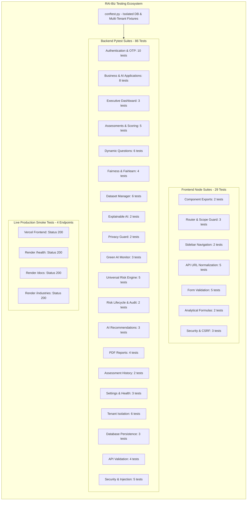

# RAI-Biz Platform-Wide Automated Testing Plan

**Project:** RAI-Biz (AI-Powered Responsible AI Governance, Assessment, and Risk Management Platform for SMEs)  
**Testing Framework:** `pytest` (Backend) + `node:test` (Frontend) + `FastAPI TestClient` (Integration)  
**Execution Environment:** Isolated SQLite (`rai_biz_test_suite.db`) + Headless Node.js v24.14.1  
**Scope Boundary:** Exclusively SME Responsible AI Governance. No Business Intelligence, Growth Advisor, or Financial Analysis modules.

---

## 1. Executive Summary & Objective

The objective of this comprehensive automated testing suite is to establish continuous, rigorous quality assurance, multi-tenant isolation verification, regression prevention, and production readiness for all 16 Responsible AI modules within RAI-Biz.

The testing architecture guarantees:
1. **Zero Production Mutation:** The production database (`backend/rai_biz.db`) is protected with pre-session and post-session SHA-256 cryptographic assertions. All test writes occur in an isolated SQLite instance.
2. **Deterministic Multi-Tenancy:** Automated fixtures establish Customer A (Suntech Mobility - Automotive Services) and Customer B (HealthNexus - Clinical Healthcare) with non-overlapping data partitions.
3. **End-to-End API Coverage:** Full CRUD, edge cases, HTTP status code validation (200, 400, 403, 404, 422, 429), and rate limiting.
4. **Client-Side Architectural Consistency:** Verification of routing, component exports, navigation wiring, API URL normalization, and analytical client calculations.

---

## 2. Test Architecture & Scope Matrix

---

## 3. Module Inventory (The 16 Governance Modules)

| # | Module Name | Primary Backend Router / Service | Frontend Route & Component | Test File |
|---|---|---|---|---|
| 01 | Email OTP Authentication | `routers/auth.py`, `email_service.py` | `/login`, `/verify-otp` | `test_authentication.py` |
| 02 | Business & AI App Management | `app/main.py` (`/api/businesses`) | `/profile` (`BusinessProfilePage.tsx`) | `test_business_management.py` |
| 03 | Overview Dashboard | `app/main.py` (`/api/dashboard`) | `/` (`DashboardPage.tsx`) | `test_dashboard.py` |
| 04 | SME Responsible AI Assessment | `services/assessment_service.py` | `/assessment` (`AssessmentPage.tsx`) | `test_assessments.py` |
| 05 | Dynamic Question Engine | `services/dynamic_assessment_engine.py`| `/assessment` (`AssessmentPage.tsx`) | `test_dynamic_questions.py` |
| 06 | Fairness & Bias Detection | `services/fairness_service.py` | `/fairness` (`FairnessPage.tsx`) | `test_fairness_bias.py` |
| 07 | Dataset Manager | `services/dataset_service.py` | `/datasets` (`DatasetManagerPage.tsx`) | `test_dataset_manager.py` |
| 08 | Explainable AI (XAI) | `services/xai_service.py` | `/xai` (`ExplainableAIPage.tsx`) | `test_explainable_ai.py` |
| 09 | Privacy Guard & PII | `services/privacy_service.py` | `/privacy` (`PrivacyGuardPage.tsx`) | `test_privacy_guard.py` |
| 10 | Green AI Monitor | `services/green_ai_service.py` | `/green-ai` (`GreenAIMonitorPage.tsx`)| `test_green_ai.py` |
| 11 | Universal Risk Engine | `services/risk_intelligence_engine.py`| `/risks` (`RiskCenterPage.tsx`) | `test_risk_engine.py` |
| 12 | Risk Lifecycle Management | `services/risk_service.py` | `/risks` (`RiskCenterPage.tsx`) | `test_risk_lifecycle.py` |
| 13 | AI Recommendations | `services/recommendation_service.py` | `/recommendations` (`RecommendationsPage.tsx`)| `test_recommendations.py` |
| 14 | Reports & PDF Generation | `services/pdf_service.py` | `/reports` (`ReportsPage.tsx`) | `test_reports.py` |
| 15 | Assessment History | `app/main.py` (`/api/assessments/history`)| `/history` (`HistoryPage.tsx`) | `test_assessment_history.py` |
| 16 | Settings & Demo Workspace | `services/demo_seed_service.py` | `/settings` (`SettingsPage.tsx`) | `test_settings.py` |

---

## 4. Safety & Cryptographic Data Protection Protocol

To eliminate risk of test pollution or data corruption:
1. `backend/tests/conftest.py` connects exclusively to `rai_biz_test_suite.db`.
2. A fixture calculates the SHA-256 hash of `backend/rai_biz.db` before test execution and asserts it matches at the conclusion of the test run:
   $$\text{Checksum} = \text{8305B703112C93B604E651933A8FECE9A93151AF8D5D255B3B457240F89B0997}$$
3. All third-party network egress during unit/integration tests (such as Resend email delivery) is mocked via dependency injection and `unittest.mock`.
4. Tests teardown temporary uploaded CSV files in `pytest` managed `tmp_path` directories automatically.
